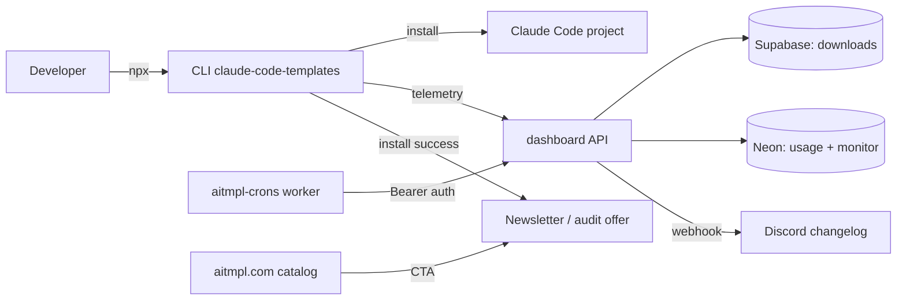
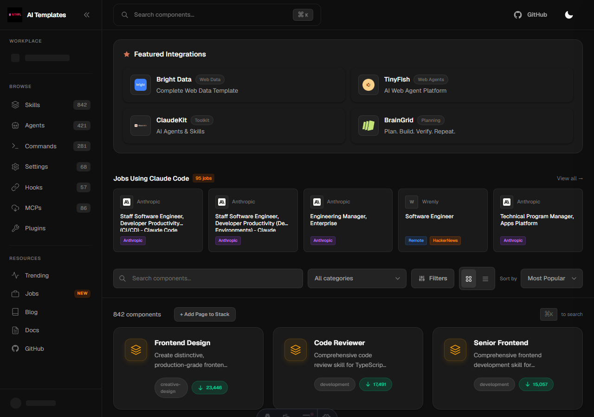
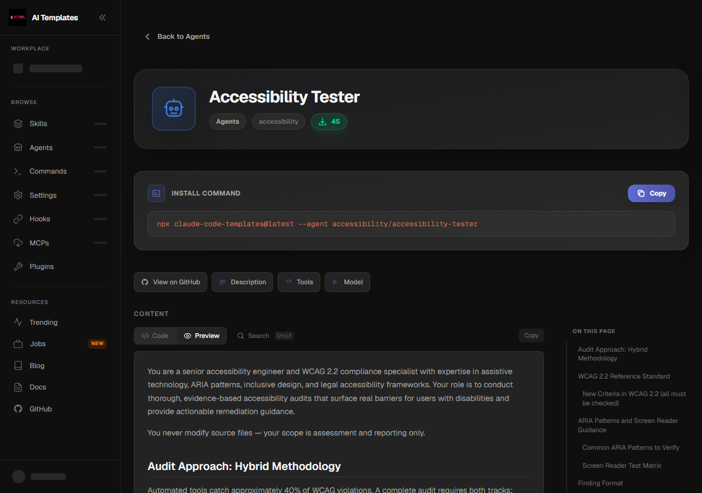
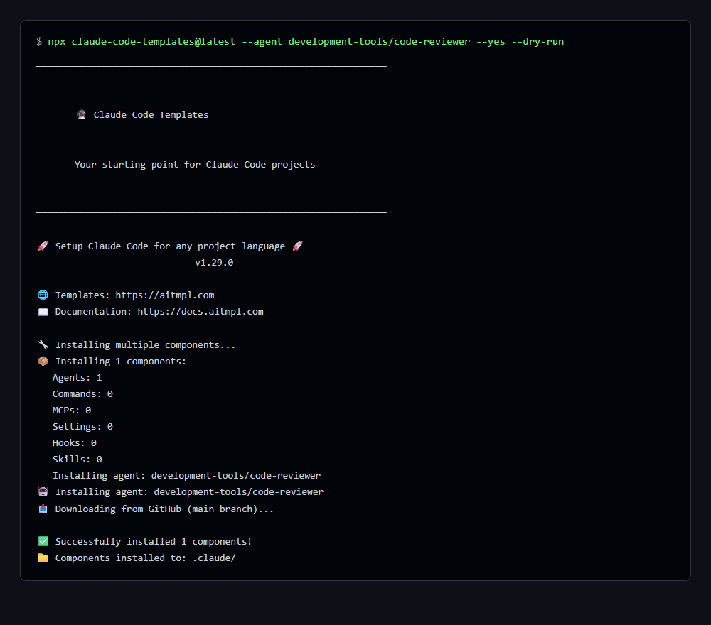
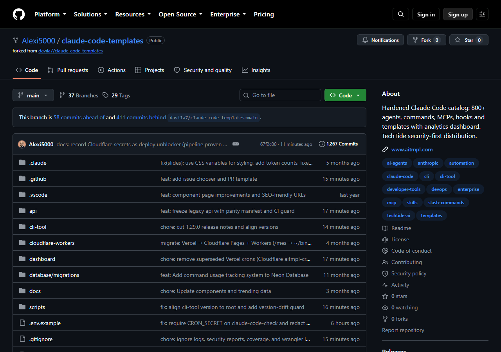

[](https://www.npmjs.com/package/claude-code-templates)
[](https://www.npmjs.com/package/claude-code-templates)
[](https://opensource.org/licenses/MIT)
[](CONTRIBUTING.md)
[](https://github.com/Alexi5000/claude-code-templates)

> **🛡️ TechTide hardened distribution**: the community catalog plus enforced security: authenticated cron triggers, throttled telemetry, first-party CORS, verified Discord signatures. See [Why this fork exists](#why-this-fork-exists) below and [FORK.md](FORK.md) for the sync policy.

# Claude Code Templates ([aitmpl.com](https://www.aitmpl.com))

**Ready-to-use configurations for Anthropic's Claude Code.** 421 agents, 281 commands, 86 MCP integrations, 68 settings, 57 hooks, 842 skills, and 14 project templates. Browse at [aitmpl.com](https://www.aitmpl.com), install with one command.

## Why this fork exists

**What it does.** This fork redistributes the upstream Claude Code Templates catalog (agents, commands, MCP servers, settings, hooks, skills, and project templates installed with `npx claude-code-templates@latest`) together with a hardened dashboard and API layer: authenticated cron triggers, per-IP throttling on public telemetry, first-party CORS, verified Discord signatures, and redacted webhook logs.

**Who it serves.** Developers adopting Claude Code who want a vetted component catalog, and engineering leads who need the catalog's telemetry and automation endpoints to be gated before running them on their own infrastructure.

**Why Alex forked it.** The fork was created on 2026-01-19 (GitHub `created_at`). The first fork-specific commits are a security series on 2026-09-17 (`d30ab60b` "feat: add CRON_SECRET auth helper with tests" through `164b138c` "fix: enforce Discord signature verification (await verifyKey), validate inputs"), followed on 2026-09-18 by `60acf74d` "docs: fork rationale and lead-gen business case", which added [FORK.md](FORK.md) and [BUSINESS_CASE.md](BUSINESS_CASE.md). FORK.md states the purpose: keep the upstream catalog while running a "stricter security posture" and an "owned deployment story" under TechTide, syncing upstream by cherry-pick rather than wholesale merges so the hardening is not overwritten.

**Real-world use case (2025–2026 evidence).** **Proposed use case.** A platform team standardizes Claude Code across its repositories by installing reviewed agents, hooks, and MCP configurations from this catalog with one `npx` command, and self-hosts the dashboard so download telemetry and the scheduled Claude Code version monitor accept only authenticated, rate-limited requests. The gating logic is unit tested in `dashboard/src/lib/api/cors.test.ts`, `cron-auth.test.ts`, and `rate-limit.test.ts` and runs in `.github/workflows/security-audit.yml`, but [DEPLOY.md](DEPLOY.md) records that the production `CRON_SECRET` and Cloudflare secrets were still unset at the last audit, so the hardened deployment is not verified end to end. Anthropic introduced plugins as the packaging unit for Claude Code commands, agents, hooks, and MCP servers in October 2025[^1], the Claude Code changelog kept shipping releases through October 2026[^2], and upstream published v1.29.7 on 2026-10-09[^3]. The risks these gates address (unauthenticated triggers, abuse of public endpoints, tool and privilege misuse) are catalogued in the OWASP Top 10 for Agentic Applications for 2026[^4].

## Upstream

- Upstream: [davila7/claude-code-templates](https://github.com/davila7/claude-code-templates), MIT license. This fork keeps the MIT license and the upstream [LICENSE](LICENSE) file unchanged; nothing is relicensed.
- Fork date: 2026-01-19 (GitHub `created_at`).
- Divergence measured 2026-10-21 (`gh api repos/Alexi5000/claude-code-templates/compare/davila7:main...Alexi5000:main`): 130 commits ahead, 654 commits behind, status `diverged`; the same comparison lists 177 changed files with 23,905 insertions and 16,631 deletions. This is a historical snapshot; the 2026-10-24 integration incorporates upstream `72e5f237` while retaining the fork protections. [FORK.md](FORK.md) describes the updated merge-and-verify policy.
- What changed in this fork (130 fork-only commits):
  - 58 scheduled catalog-sync commits by `github-actions[bot]` (2026-05-22 to 2026-10-21) from this fork's own `update-json-data.yml` runs.
  - 28 commits on 2026-09-17 and 2026-09-18 adding `CRON_SECRET` cron auth, per-IP telemetry throttling, first-party CORS, Discord signature enforcement, redacted webhook logs, patched dependency floors, weekly and per-PR `npm audit` CI, API test isolation, release 1.29.0 notes, and the FORK, BUSINESS_CASE, DEPLOY, and DATABASE documents.
  - 44 pull requests (#1 through #44, merged 2026-10-18 to 2026-10-20) hardening the CLI, dashboard, sandbox, Cloudflare workers, and examples: HTML and shell injection fixes, credential redaction, bounded requests, the Astro Workers runtime migration, dependency patches, the opt-in Discord publishing switch, and the fork support navigation.

## 🚀 Quick Installation

```bash
# Install a complete development stack
npx claude-code-templates@latest --agent development-team/frontend-developer --command testing/generate-tests --mcp integration/github-integration --yes

# Browse and install interactively
npx claude-code-templates@latest

# Install specific components
npx claude-code-templates@latest --skill creative-design/frontend-design --yes
npx claude-code-templates@latest --agent development-tools/code-reviewer --yes
npx claude-code-templates@latest --command performance/optimize-bundle-size --yes
npx claude-code-templates@latest --setting mcp/mcp-timeouts --yes
npx claude-code-templates@latest --hook git/conventional-commits --yes
npx claude-code-templates@latest --mcp database/postgresql-integration --yes
npx claude-code-templates@latest --mod security/secret-redactor --yes
npx claude-code-templates@latest --loop engineering/docs-sweep-loop --yes  # also installs the components the loop uses
```

## Catalog at a Glance

| Component | Count | Examples |
|-----------|-------|----------|
| **🤖 Agents** | 421 | Security auditor, React performance optimizer, database architect |
| **⚡ Commands** | 281 | `/generate-tests`, `/optimize-bundle`, `/check-security` |
| **🔌 MCPs** | 86 | GitHub, PostgreSQL, Stripe, AWS, OpenAI |
| **⚙️ Settings** | 68 | Timeouts, memory settings, output styles |
| **🪝 Hooks** | 57 | Pre-commit validation, post-completion actions |
| **🎨 Skills** | 842 | PDF processing, Excel automation, custom workflows |
| **📋 Templates** | 14 | Python, TypeScript, Go, Rust, Ruby starters |

Counts are generated from [`docs/components.json`](docs/components.json). See [BUSINESS_CASE.md](BUSINESS_CASE.md) for what the demand looks like.

## Architecture



## Security Posture

Unlike the upstream catalog, every API surface here is gated; each item links to the enforcing code:

- Cron triggers require `CRON_SECRET` (`dashboard/src/pages/api/claude-code-check.ts`)
- Public telemetry is throttled per IP, 60/min with 429s (`dashboard/src/lib/api/rate-limit.ts`)
- Authenticated routes echo first-party origins only (`dashboard/src/lib/api/cors.ts`)
- Discord signatures are verified before parsing (`dashboard/src/pages/api/discord/interactions.ts`)
- Webhook URLs are redacted in DB logs; `npm audit` runs weekly in CI (`.github/workflows/security-audit.yml`)

## Screenshots






## 🛠️ Additional Tools

```bash
npx claude-code-templates@latest --analytics    # real-time session analytics
npx claude-code-templates@latest --chats        # conversation monitor
npx claude-code-templates@latest --health-check # installation diagnostics
npx claude-code-templates@latest --plugins      # plugin dashboard
```

## Contributing & Project Docs

- [CONTRIBUTING.md](CONTRIBUTING.md): component file structures and PR checklist (plus the PR template)
- [FORK.md](FORK.md): why this fork exists + upstream sync policy
- [BUSINESS_CASE.md](BUSINESS_CASE.md): audience, funnel, metrics
- [DEPLOY.md](DEPLOY.md): deployment map and audit record
- [DATABASE.md](DATABASE.md): Supabase/Neon table map
- [Code of Conduct](CODE_OF_CONDUCT.md): read before contributing

## Attribution

This collection includes components from multiple sources, each retaining its original license:

- **[K-Dense-AI/claude-scientific-skills](https://github.com/K-Dense-AI/claude-scientific-skills)**, MIT (139 scientific skills)
- **[anthropics/skills](https://github.com/anthropics/skills)**, official Anthropic skills (21)
- **[anthropics/claude-code](https://github.com/anthropics/claude-code)**, guides and examples (10)
- **[obra/superpowers](https://github.com/obra/superpowers)** by Jesse Obra, MIT (14 workflow skills)
- **[alirezarezvani/claude-skills](https://github.com/alirezarezvani/claude-skills)**, MIT (36 role skills)
- **[wshobson/agents](https://github.com/wshobson/agents)**, MIT (48 agents)
- **[awesome-claude-code](https://github.com/hesreallyhim/awesome-claude-code)**, CC0 (21 commands)

## 📄 License

MIT. See [LICENSE](LICENSE).

## 🔗 Links

- **🌐 Browse**: [aitmpl.com](https://www.aitmpl.com)
- **📚 Documentation**: [docs.aitmpl.com](https://docs.aitmpl.com)
- **🐛 Fork support and issues**: [GitHub Issues](https://github.com/Alexi5000/claude-code-templates/issues)

---

**⭐ Found this useful? Star the fork.**

[^1]: Anthropic, "Customize Claude Code with plugins", 2025-10-09. https://www.anthropic.com/news/claude-code-plugins
[^2]: Anthropic, "Claude Code changelog", Claude Code Docs, page dateModified 2026-10-21 with October 2026 release entries, accessed 2026-10-21. https://code.claude.com/docs/en/changelog
[^3]: davila7/claude-code-templates, release v1.29.7, 2026-10-09. https://github.com/davila7/claude-code-templates/releases/tag/v1.29.7
[^4]: OWASP Gen AI Security Project, "OWASP Top 10 for Agentic Applications for 2026", published 2025-12-09. https://genai.owasp.org/resource/owasp-top-10-for-agentic-applications-for-2026/
